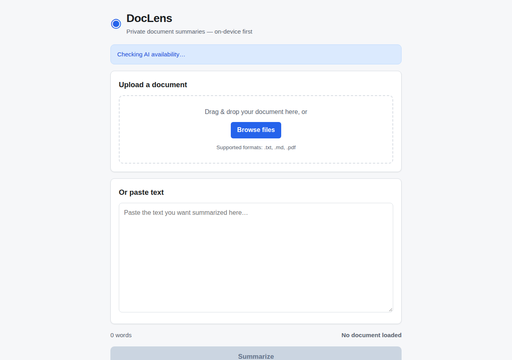
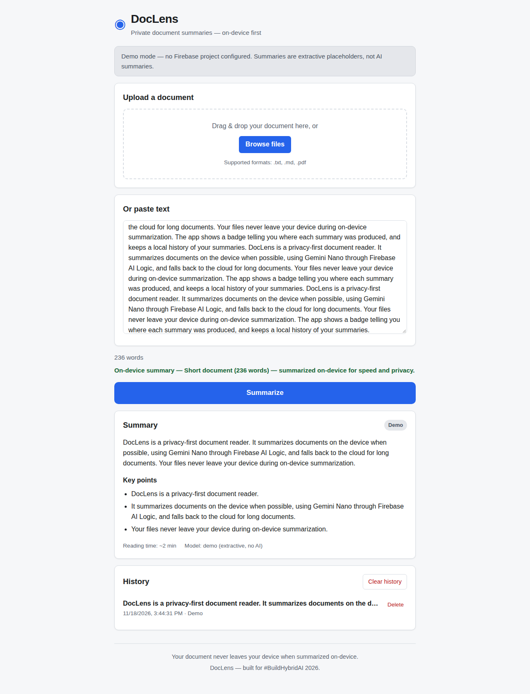

# DocLens

**DocLens** is a privacy-first document reader for the web. Upload a document
or paste text, click **Summarize**, and get a short summary, key points, and
an estimated reading time — without your document ever leaving your device
unless it has to.

Built for **#BuildHybridAI 2026**.

## The privacy story

Most summarizers upload your whole document to a server before doing
anything. DocLens does the opposite:

1. **Your document stays yours.** Text extraction (`.txt`, `.md`, `.pdf`)
   happens entirely in the browser with pdf.js. Nothing is uploaded to
   extract text.
2. **Short documents never leave the device.** Documents up to 2,000 words
   are summarized on-device with Gemini Nano through Firebase AI Logic
   (the Prompt API / `LanguageModel` in Chrome). No network request, no
   server copy, and it works offline once the model is downloaded.
3. **Long documents use the cloud — and say so.** Documents over 2,000 words
   go to the cloud model (`gemini-2.5-flash`) via Firebase AI Logic, because
   long context needs a larger model. The inference badge on every result
   always shows where the summary came from: **On-device**, **Cloud**, or
   **Demo**.
4. **History stays in your browser.** Past summaries are kept in
   `localStorage` on your own machine (max 20 entries) and are never sent
   anywhere. Clearing them is one click.

## How hybrid inference works

| Document | Route | Model | Where it runs |
| --- | --- | --- | --- |
| ≤ 2,000 words | On-device | Gemini Nano (via Firebase AI Logic) | In your browser |
| > 2,000 words | Cloud | `gemini-2.5-flash` (via Firebase AI Logic) | Google Cloud |

The routing decision is made locally by `routeForDocument()` in
[`src/docs.js`](src/docs.js) from the word count alone — the text itself is
not inspected by any server to decide the route. The result panel shows an
inference badge (`#inference-badge`) so you can always see which path was
taken for a given summary.

## Features

- **Upload or paste** — drag & drop or pick a `.txt`, `.md`, or `.pdf` file,
  or paste text directly. PDFs are parsed page by page in the browser.
- **Live word count & routing indicator** — see the word count and whether
  the document will be summarized on-device or in the cloud before you
  click anything.
- **Summary + key points + reading time** — a concise summary, the main
  points as a list, and an estimated reading time in minutes.
- **Inference badge** — every result is labelled On-device, Cloud, or Demo.
- **Local history** — the last 20 summaries, stored only in your browser;
  reopen or delete individual entries, or clear all.
- **Honest demo mode** — without a Firebase project configured, the app
  still works end to end with a clearly-labelled extractive fallback (see
  [Demo mode](#demo-mode)). It never pretends a placeholder is an AI
  summary.

## How to run

Prerequisites: Node.js 22+ and npm.

```bash
npm install
npm run dev      # start the Vite dev server (http://localhost:5173)
npm run build    # production build into dist/
npm run preview  # serve the production build (http://localhost:4173)
npm test         # run the smoke test (tests/smoke.mjs)
```

## Demo mode

If no Firebase project is configured (the default state of a fresh clone),
DocLens runs in **demo mode**. The banner at the top of the page says so
plainly:

> Demo mode — no Firebase project configured. Summaries are extractive
> placeholders, not AI summaries.

In demo mode, `summarize()` returns an **extractive** summary: the leading
sentences of your own text, plus key points taken from it. No text is sent
anywhere and no AI model is involved. The inference badge shows **Demo**,
and the model is reported as an extractive fallback — never as Gemini.

To get real AI summaries, connect a Firebase project (below).

## How to connect a real Firebase project

1. **Create a Firebase project** at the
   [Firebase console](https://console.firebase.google.com/) (or reuse an
   existing one).
2. **Enable Firebase AI Logic:** in the console, go to **AI Logic** and
   click **Get started**.
3. **Choose the Gemini Developer API** as the backend when prompted.
4. **Register a web app:** in **Project settings → Your apps**, add a Web
   app (`</>`) and copy the Firebase configuration object it shows you.
5. **Paste the config into [`src/firebase-config.js`](src/firebase-config.js)**,
   replacing the placeholder values. Only the public web-app config belongs
   here — never a private key.
6. **(Optional, for local development) Enable App Check with a debug token:**
   follow the Firebase App Check documentation to create a debug token for
   your development machine and use it only locally.
   > ⚠️ **Warning:** never commit an App Check debug token, a service
   > account key, or a Gemini API key to the repository. Debug tokens are
   > for your machine only. `.gitignore` already excludes `.env` files —
   > keep secrets there (or in your Firebase console), never in source.
7. **Rebuild and verify:** run `npm run build && npm test`, then paste a
   short document and confirm the badge reads **On-device**, and a long
   document (over 2,000 words) reads **Cloud**.

## Project structure

```
doclens/
├── index.html              # App shell and DOM ids used by the UI
├── vite.config.js          # Vite config (relative base, dist/ output)
├── src/
│   ├── main.js             # UI wiring: DOM <-> ai.js / docs.js / history.js
│   ├── ai.js               # Firebase AI Logic: initAI(), summarize(), getAIStatus()
│   ├── docs.js             # Text extraction (pdf.js), word count, routing
│   ├── history.js          # localStorage history (max 20 entries)
│   ├── firebase-config.js  # Firebase web-app config (placeholder by default)
│   └── styles.css          # App styling
├── tests/
│   └── smoke.mjs           # Playwright smoke test (static + browser checks)
├── README.md
├── LICENSE                 # Apache License 2.0
└── .gitignore
```

Module contracts:

- `src/ai.js` — `initAI()` → `{ mode, detail }`;
  `summarize(text, onProgress)` → `{ summary, keyPoints, readingMinutes,
  inferenceSource, modelUsed, wordCount }`; `getAIStatus()`.
- `src/docs.js` — `extractTextFromFile(file)` → `{ text, fileName,
  pageCount? }`; `countWords(text)` → `number`;
  `routeForDocument(text)` → `{ route: 'on-device' | 'cloud', reason }`.
- `src/history.js` — `saveSummary(entry)`, `loadHistory()` → array,
  `clearHistory()`, `deleteHistoryItem(id)`; storage key
  `doclens-history-v1`.

## Testing

```bash
npm test
```

`tests/smoke.mjs` runs in two phases and prints a `PASS`/`FAIL` line per
check (exit code `0` on pass, `1` on failure):

- **Phase 0 — static checks:** required files exist, required DOM ids are
  present in `index.html`, `main.js` imports the contract modules, and no
  secrets are hard-coded.
- **Phase 1 — browser checks (Playwright):** serves the production build
  with `vite preview`, opens it in headless Chromium, verifies the title
  and that **Summarize** starts disabled, pastes a ~120-word sample,
  checks the word count and on-device route indicator update, clicks
  **Summarize**, and waits up to 60 seconds for a non-empty summary and a
  badge. It also records whether `window.LanguageModel` exists in the
  launched Chromium (logged only, never a pass/fail condition) and fails
  if any fatal JS error (`pageerror`) occurs.

Without a Firebase project the browser phase runs against demo mode and
accepts the demo badge/summary as a pass.

`npm run verify` (`tests/verify-deep.mjs`) additionally checks PDF upload
end-to-end, long-document routing to the cloud route, history persistence
across a page reload, and the `window.LanguageModel` probe.

## Verification status (2026-11-18, this machine)

Verified working end-to-end (see `tests/verify-deep.mjs`):

- `npm run build` succeeds; `npm test` passes all checks in ~2s;
  `npm run verify` passes all deep checks (PDF upload, long-doc cloud
  routing, history persistence, zero JS errors).
- `window.LanguageModel` exists in the bundled Chromium 159 and
  `LanguageModel.availability()` returns `"downloadable"`.

**Honest limitations — what could NOT be verified here:**

- **Live on-device generation is NOT proven on this machine.**
  Three configurations were tried (`tests/probe-nano.mjs`,
  `tests/probe-nano-chrome.mjs`, `tests/probe-nano-chrome-headed.mjs`):
  the Playwright Chromium build exposes the Prompt API but has no real
  model — `create()` succeeds yet merely echoes the input back; real
  Google Chrome 158 (headless and headed under Xvfb) reports
  `LanguageModel.availability() === "unavailable"`, i.e. the Gemini Nano
  model component is not present in this environment. The on-device code
  path (`initializeDeviceModel()` + `PREFER_ON_DEVICE` + `inferenceSource`
  badge) is written exactly per the Firebase AI Logic docs and the
  `inferenceSource` accessor + Schema API were verified against the
  installed firebase 13.4.0 SDK source — but a real on-device summary has
  not been observed yet. Verify it on a desktop Google Chrome with the
  model downloaded before recording the demo video.
- **Live cloud generation is NOT proven here either** — it needs a real
  Firebase project (Gemini Developer API backend). Connect one as
  described above, then re-run `npm test` and confirm the badge reads
  "Summarized in the cloud" / "Summarized on-device" as appropriate.

## Screenshots




## Tech stack

- [Vite](https://vite.dev/) — dev server and production build
- [Firebase AI Logic](https://firebase.google.com/docs/vertex-ai)
  (Firebase JS SDK) — on-device Gemini Nano and cloud `gemini-2.5-flash`
- [pdf.js](https://mozilla.github.io/pdf.js/) (`pdfjs-dist`) — in-browser
  PDF text extraction
- [Playwright](https://playwright.dev/) — browser smoke test

## License

Apache License 2.0 — see [LICENSE](LICENSE).

Copyright 2026 DocLens contributors.
